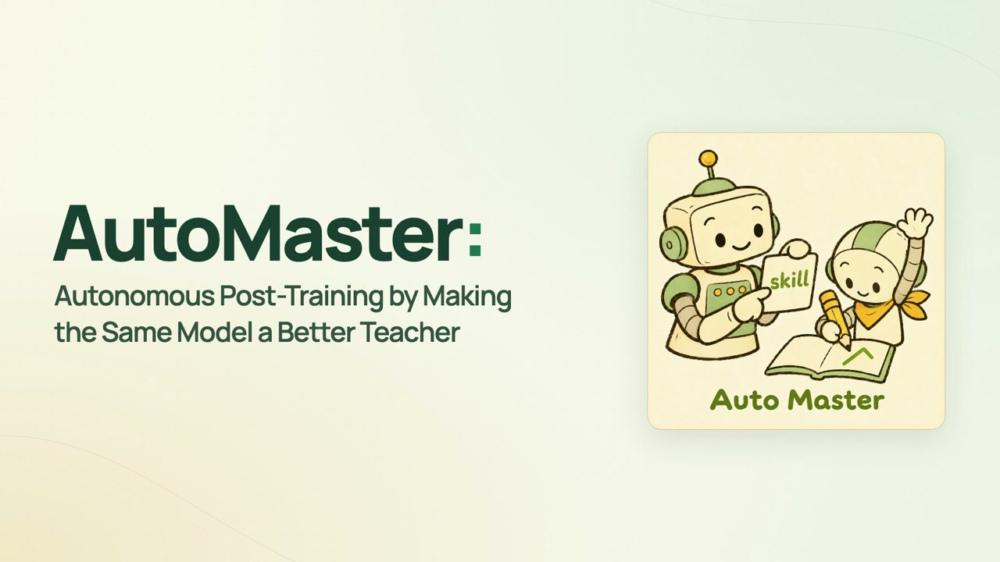
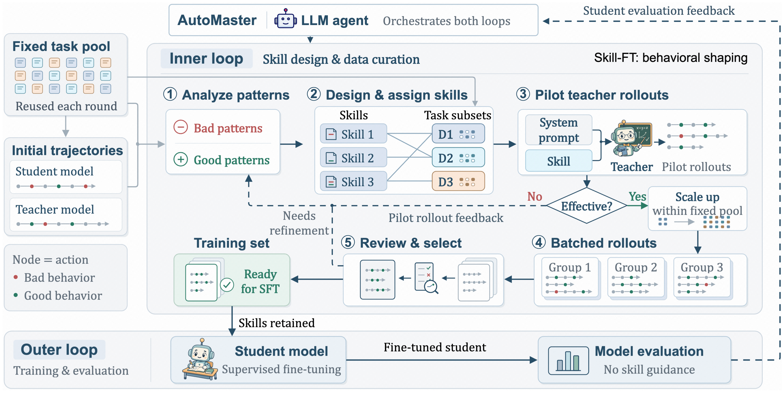
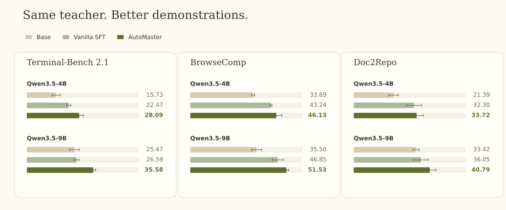

<div align="center">


## Autonomous Post-Training by Making the Same Model a Better Teacher

*Beyond task success: **autonomously shaping teacher behavior to improve what students learn**.*

[Video](#how-automaster-works) · [Inside AutoMaster](#inside-automaster) · [Results](#results-across-three-domains) · [Insights](#key-insights) · [Skills](skills/README.md) · [Quick start](#quick-start) · [Models & data](https://huggingface.co/collections/RUC-AIBOX/automaster) · [Citation](#citation)

[](https://arxiv.org/pdf/2611.26510)
[](https://aweai-team.github.io/AutoMaster/)
[](https://huggingface.co/collections/RUC-AIBOX/automaster)<br>
[](skills/README.md)
[](LICENSE)

*If you find AutoMaster useful, give us a star ⭐ to support the project.*

</div>

**AutoMaster** autonomously studies trajectories, designs skills, and selects demonstrations to make the same model a better teacher. **Skill-FT** guides Teacher rollouts with these skills and fine-tunes the Student on the resulting demonstrations. The Student is evaluated without generated skills.

This release includes [nine selected skills](skills/README.md) and [inference recipes](recipes/inference/README.md) for three domains, powered by [AweAgent](https://github.com/AweAI-Team/AweAgent).

## How AutoMaster works

<p align="center">
  <a href="https://aweai-team.github.io/AutoMaster/assets/overview.mp4?v=cbf0f5c8"></a><br>
  <a href="https://aweai-team.github.io/AutoMaster/assets/overview.mp4?v=cbf0f5c8"><b>▶ Watch the overview</b></a>
</p>

## Inside AutoMaster

<p align="center">
  <a href="assets/framework.png"></a>
</p>

**Inner loop · Shape the demonstrations.** Analyze behaviors, design and test skills, and select training examples. Skills can apply to overlapping task subsets, with different combinations for different tasks.

**Outer loop · Learn from the Student.** Train and evaluate the Student, then use its scores and execution traces to refine the next round of skill design and data selection.

[Explore the method and behavioral examples →](docs/method.md)

## Results across three domains

<p align="center">
  <a href="assets/readme/results.svg"></a>
</p>

## Key insights

- **Task success alone does not tell us what a demonstration teaches.** Even successful trajectories can contain unsupported assumptions, unproductive exploration, or superficial verification. Training on them can reinforce these habits alongside useful behaviors.

- **Better teaching without a stronger teacher.** Shaping how a fixed Teacher executes tasks can improve its demonstrations. AutoMaster improves mean Student performance by **1.42–8.99 percentage points** over Vanilla SFT, with the Teacher, task pool, training set size, and SFT recipe held fixed.

- **Generation and selection are complementary.** Skills shape the behaviors demonstrated; selection identifies valuable training examples. Removing either component lowers mean performance in all six evaluated settings, supporting their joint optimization.

- **Skill context helps behavioral internalization.** Keeping skill instructions during SFT improves mean performance by **2.15–4.01 percentage points** over removing them, with identical trajectories and supervised outputs—and no generated skills at evaluation. Explicit behavioral rules and their conditions of application offer a possible explanation.

- **Autonomous post-training benefits from exploration.** Rollout evidence and Student evaluation guide further skill design and data selection. Continued experimentation can uncover better candidates after limited progress; individual rounds need not improve monotonically.

## Skills in practice

Each skill is a self-contained folder with a `SKILL.md` entrypoint.

| Terminal tasks | Web search | Repository construction |
|---|---|---|
| [Test a numerical claim](skills/tb2.1/execute-numeric-decision/SKILL.md) | [Break out of a stalled search](skills/bc/recover-search-anchor/SKILL.md) | [Exercise the public API](skills/doc2repo/run-observed-public-call/SKILL.md) |
| Compare against an independent reference and test the required bound. | Drop unsupported assumptions and follow a new identifying clue. | Call the real entry point and observe its external effects. |

[Explore all nine skills and teacher instructions](skills/README.md#what-the-teacher-reads) · [See how skills change a rollout](docs/method.md#behavioral-shaping-in-practice)

## Quick start

### 1. Set up the inference environment

```bash
git clone --recurse-submodules https://github.com/RUCAIBox/AutoMaster.git
cd AutoMaster
python3 -m venv .venv
source .venv/bin/activate
python -m pip install -e './third_party/AweAgent[search]'
```

Use Python 3.11 or newer. Already cloned without submodules? Run `git submodule update --init --recursive`.

### 2. Serve a checkpoint

In a separate environment with a Qwen3.5-compatible SGLang installation:

```bash
export MODEL_PATH='/path/to/checkpoint'  # A Hugging Face model ID also works.
export SERVED_MODEL_NAME=automaster
bash recipes/inference/serve_qwen35.sh
```

Set `TP` for tensor parallelism. Keep the checkpoint's tokenizer and chat template with its weights. An existing OpenAI-compatible endpoint can also be used directly.

### 3. Evaluate the model

Configure the task assets and any required external services using the [inference guide](recipes/inference/README.md), then run one task:

```bash
awe-agent run --config recipes/inference/doc2repo.yaml --max-instances 1
```

Use `--num-rollouts 3` for three evaluations; choose `terminal.yaml`, `browsecomp.yaml`, or `doc2repo.yaml` for the benchmark.

## Repository structure

```text
AutoMaster/
├── skills/                # Nine original skills, grouped by domain
├── recipes/inference/     # HF/local-model serving and evaluation configurations
├── third_party/AweAgent/  # Public inference harness, pinned Git submodule
├── docs/                  # Method and behavioral examples
└── assets/                # Project artwork and manuscript figures
```

## Acknowledgments and license

Built with [AweAgent](https://github.com/AweAI-Team/AweAgent) and Qwen3.5, evaluated on Terminal-Bench 2.1, BrowseComp and Doc2Repo. We thank the developers of these models, benchmarks and tools.

AutoMaster-authored code, documentation and skills use the [MIT License](LICENSE). AweAgent retains its [Apache-2.0 license](third_party/AweAgent/LICENSE); model weights, datasets and benchmark assets retain their own licenses.

For changes or bug reports, see [Contributing](CONTRIBUTING.md).

## Citation

If you use AutoMaster in your research, please cite:

```bibtex
@misc{chen2026automasterautonomousposttrainingmaking,
  title={AutoMaster: Autonomous Post-Training by Making the Same Model a Better Teacher},
  author={Guoxin Chen and Shuang Sun and Fanzhe Meng and Xinyu Tang and Ruihua Song and Wayne Xin Zhao},
  year={2026},
  eprint={2611.26510},
  archivePrefix={arXiv},
  primaryClass={cs.CL},
  url={https://arxiv.org/abs/2611.26510},
}
```
