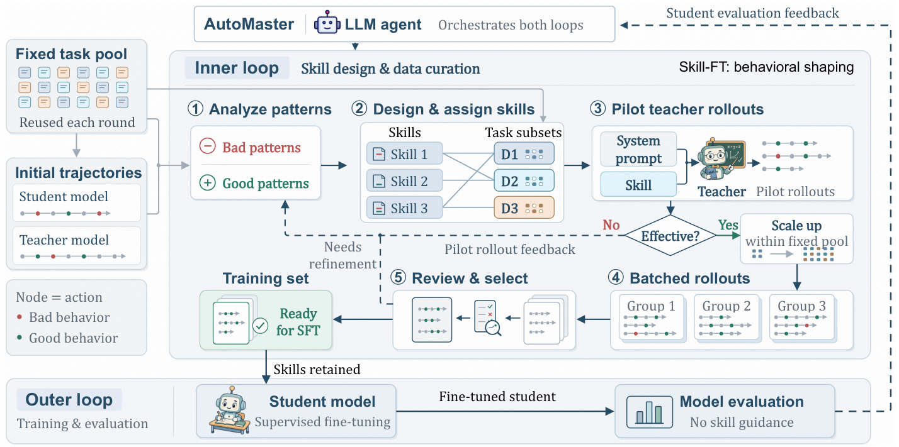

<div align="center">

# AutoMaster
### Autonomous Post-Training by Making the Same Model a Better Teacher

**Discover better teaching behaviors. Generate better demonstrations. Train stronger agents.**

[Method](#method) · [Results](#results) · [Skills](skills/README.md) · [Quick start](#quick-start) · [Models & data](docs/resources.md)

[](skills/README.md)
[](recipes/inference/README.md)
[](LICENSE)

</div>

**Task success alone does not specify which behaviors post-training should reinforce.** A successful teacher can still make unsupported claims, repeat unproductive searches, or test a substitute instead of the implementation it delivers.

**Skill-FT** uses natural-language skills to shape the Teacher's actual execution, then fine-tunes a Student on the resulting demonstrations. **AutoMaster** automates the research process: analyze trajectories, design and test interventions, curate data, train, evaluate, and refine.

This first release provides **nine selected skills** and **inference recipes for three domains**, backed by a pinned public [AweAgent](https://github.com/AweAI-Team/AweAgent) dependency. Links to the paper, six checkpoints and trajectory datasets will be added to the [resource index](docs/resources.md) when published. The autonomous training controller is outside this release.

## Method

<p align="center">
  
</p>

1. **Analyze & design.** Study Student, unguided Teacher and available reference-model trajectories to identify useful behavioral interventions.
2. **Generate & curate.** Inject selected skills into the Teacher's system prompt, execute tasks, inspect the resulting behavior, and select training demonstrations. Skills and task subsets have a many-to-many relationship.
3. **Train & evaluate.** Fine-tune the Student with skill context retained in the training input. Evaluate without adding the generated skills, then use the results to guide further research.

The Teacher stays fixed; the research agent improves how it produces teaching demonstrations. Read the [method guide](docs/method.md) for the distinction between AutoMaster, Skill-FT and the released skills.

## Results

Main results from the accompanying manuscript. Scores are percentages, reported as **mean ± sample SD over three evaluations**. Terminal-Bench 2.1 and BrowseComp use task accuracy; Doc2Repo uses mean test pass rate.

| Benchmark | Student | Base | Vanilla SFT | AutoMaster |
|---|---|---:|---:|---:|
| Terminal-Bench 2.1 | Qwen3.5-4B | 15.73 ± 2.25 | 22.47 ± 1.12 | **28.09 ± 2.25** |
| Terminal-Bench 2.1 | Qwen3.5-9B | 25.47 ± 2.59 | 26.59 ± 1.30 | **35.58 ± 1.30** |
| BrowseComp | Qwen3.5-4B | 33.69 ± 0.82 | 43.24 ± 0.54 | **46.13 ± 2.98** |
| BrowseComp | Qwen3.5-9B | 35.50 ± 2.72 | 46.85 ± 2.98 | **51.53 ± 1.25** |
| Doc2Repo | Qwen3.5-4B | 21.39 ± 2.61 | 32.30 ± 4.00 | **33.72 ± 3.58** |
| Doc2Repo | Qwen3.5-9B | 33.42 ± 1.60 | 36.05 ± 3.89 | **40.79 ± 3.21** |

Vanilla SFT trains on 512 selected unguided demonstrations from the same Teacher. AutoMaster also uses 512 training examples. The selected skill library illustrates interventions explored during research; it is not the full training recipe for each checkpoint.

## Explore the skills

Each skill is a self-contained folder with a `SKILL.md` entrypoint.

| Domain | A representative intervention | Start here |
|---|---|---|
| Terminal | Make a numerical requirement an executed acceptance decision | [execute-numeric-decision](skills/tb2.1/execute-numeric-decision/SKILL.md) |
| Search | Recover a stalled query by revisiting its unsupported assumption | [recover-search-anchor](skills/bc/recover-search-anchor/SKILL.md) |
| SWE | Exercise the real public call chain and observe its external effects | [run-observed-public-call](skills/doc2repo/run-observed-public-call/SKILL.md) |

Browse [all nine skills](skills/README.md). Select by the task's behavior and interfaces; there is no need to inject the entire library. Released Student inference does **not** require these skills in the prompt.

## Quick start

### 1. Get AutoMaster and the inference dependency

```bash
git clone --recurse-submodules https://github.com/RUCAIBox/AutoMaster.git
cd AutoMaster
python3 -m venv .venv
source .venv/bin/activate
python -m pip install -e './third_party/AweAgent[search]'
```

Use Python 3.11 or newer. Already cloned without submodules? Run `git submodule update --init --recursive`.

### 2. Serve a checkpoint

In a separate environment with a Qwen3.5-compatible SGLang installation:

```bash
export MODEL_PATH='/path/to/checkpoint'  # A Hugging Face model ID also works.
export SERVED_MODEL_NAME=automaster
bash recipes/inference/serve_qwen35.sh
```

Set `TP` for tensor parallelism. Keep the checkpoint's tokenizer and chat template with its weights. An existing OpenAI-compatible endpoint can also be used directly.

### 3. Run a benchmark

Configure the task assets and any required external services using the [inference guide](recipes/inference/README.md), then run one task:

```bash
awe-agent run --config recipes/inference/doc2repo.yaml --max-instances 1
```

Each domain has a YAML recipe and supports `--num-rollouts 3`. See [settings and prerequisites](docs/evaluation.md) for time budgets, sampling and search/Judge configuration.

## Repository

```text
AutoMaster/
├── skills/                # Nine original skills, grouped by domain
├── recipes/inference/     # HF/local-model serving and evaluation configurations
├── third_party/AweAgent/  # Public inference harness, pinned Git submodule
├── docs/                  # Method, resources and evaluation guide
└── assets/readme/          # Framework figure from the manuscript
```

## Acknowledgments and license

Built with [AweAgent](https://github.com/AweAI-Team/AweAgent) and Qwen3.5, evaluated on Terminal-Bench 2.1, BrowseComp and Doc2Repo. We thank the developers of these models, benchmarks and tools.

AutoMaster-authored code, documentation and skills use the [MIT License](LICENSE). AweAgent retains its Apache-2.0 license; model weights, datasets and benchmark assets retain their own licenses. See [third-party notices](THIRD_PARTY_NOTICES.md).

Paper and citation links will be added with the publication. For changes or bug reports, see [Contributing](CONTRIBUTING.md).
