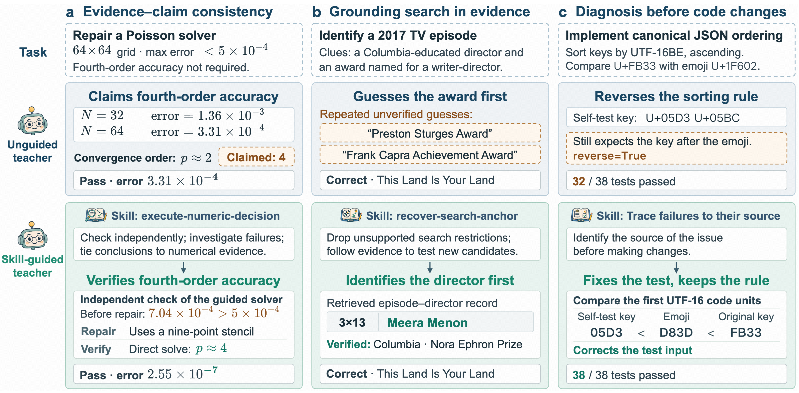

# AutoMaster and Skill-FT

**Skill-FT is the training-data intervention.** A skill specifies a useful execution behavior: when it applies, what action changes, and how to judge the result. Selected skill instructions are appended to the Teacher's system prompt before rollout. The Teacher then interacts with tools and the environment to produce a new demonstration.

Skills can suppress an undesirable habit or elicit an effective behavior that appears too rarely. This includes improving already-successful executions: independently checking a numerical claim, verifying the final saved artifact, following retrieved evidence instead of a familiar guess, or testing an actual dependency interface.

**AutoMaster is the autonomous research system.** Its research agent examines Student trajectories, unguided Teacher trajectories and available reference-model trajectories. It designs interventions, tests them through pilot executions, revises their scope, expands useful candidates and selects demonstrations. Student SFT and evaluation provide feedback for further research. The research agent and the trained Student are separate roles.

## Behavioral shaping in practice

  

These cases illustrate changes in execution, not just changes in wording. In the numerical and search examples, both executions succeed, yet differ in how they establish their conclusions. In the repository example, diagnosis preserves the specified ordering rule and improves test coverage. Click the figure to inspect the details.

Read two of the illustrated interventions: [execute-numeric-decision](../skills/tb2.1/execute-numeric-decision/SKILL.md) and [recover-search-anchor](../skills/bc/recover-search-anchor/SKILL.md).

## Skills and data selection work together

A skill can apply to many tasks, a task can receive several skills, and different subsets can use different combinations. Task subsets can overlap. The research agent selects individual generated demonstrations rather than assuming that every rollout using a skill is equally useful.

Task outcomes and learning value are distinct. A successful trajectory can contain weak behavior. In repository construction, a partially correct implementation can still demonstrate useful construction or diagnosis. The research process considers actual behavior alongside task feedback and data quality.

## Training and deployment

The selected demonstrations are used for standard supervised fine-tuning. The retained system prompt includes the skills used to produce that demonstration; supervision applies to assistant outputs. Each outer-round candidate starts from the initial Student checkpoint and is evaluated to inform subsequent research. At evaluation, the generated skills are not added to the Student's prompt.

The first public release contains a selected skill collection and inference recipes. The autonomous research controller, Teacher-generation service and SFT orchestration are not included in this release.
