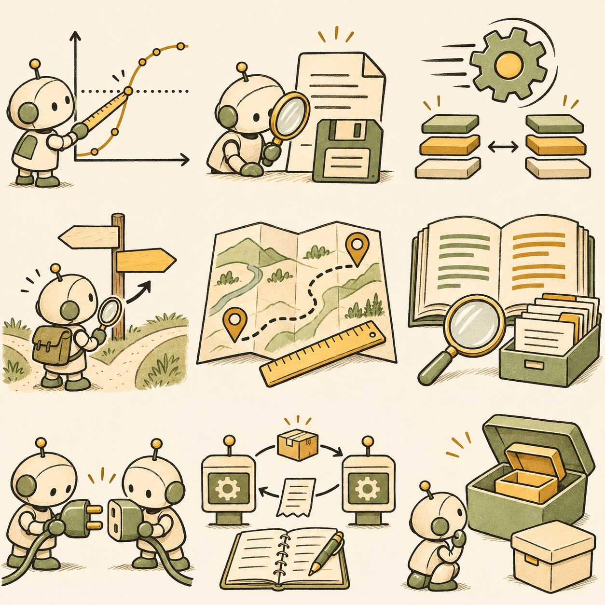

# Skills discovered by AutoMaster

Nine selected skills from historical AutoMaster research runs, organized by domain:

- [Terminal tasks](tb2.1/README.md): numerical acceptance, final-deliverable verification, and semantics-preserving optimization.
- [BrowseComp / web search](bc/README.md): stalled-search recovery, faithful interpretation of measurements, and source-language retrieval.
- [Repository construction](doc2repo/README.md): dependency contracts, observable public calls, and parser ownership.

Each skill has its own directory and a `SKILL.md` with `name` and `description` frontmatter. The original skill text is preserved byte-for-byte. Domain indexes describe applicability and available evidence; `catalog.json` records file paths and hashes.

## What the teacher reads

  

### Terminal tasks

<b>Test a numerical claim</b>

When a solver must satisfy an error bound, compare its output with an **independent reference**. Keep the failing input and the **original tolerance** while diagnosing the error.

> Define the reference and bound before running this block.

[Read execute-numeric-decision](tb2.1/execute-numeric-decision/SKILL.md)

<b>Check the saved result</b>

When a task delivers a file, model, or service, use the **same entry point** its user will use. Measure the requested property on that **final output**.

> Exercise the finished deliverable.

[Read verify-consumer](tb2.1/verify-consumer/SKILL.md)

<b>Keep exact results during optimization</b>

When faster code must **match a reference exactly**, first speed up the work around sensitive operations. Check **tied rankings** and floating-point reductions against the reference.

> Measure this conservative implementation against the required performance target.

[Read preserve-reference-operations](tb2.1/preserve-reference-operations/SKILL.md)

### Web search

<b>Break out of a stalled search</b>

When repeated queries lead to the same weak candidate, find the **guessed detail** they share. Drop it and search a clue that could **independently identify the target**.

> Drop that guessed restriction from the next discovery query.

[Read recover-search-anchor](bc/recover-search-anchor/SKILL.md)

<b>Check what a distance measures</b>

When distance could rule a candidate in or out, check the **endpoints, units, and travel mode**. A nearby station may explain a clue while leaving the requested walking distance unknown.

> Before using a returned number, identify its two endpoints, what was measured, and its units.

[Read measured-relations](bc/measured-relations/SKILL.md)

<b>Search in the source’s own terms</b>

When English summaries omit a local fact, keep **one verified name or institution** and search for the missing relationship in the **language of the relevant record**.

> Preserve names, dates, and roles.

[Read source-terms](bc/source-terms/SKILL.md)

### Repository construction

<b>Find which object owns the work</b>

When framework objects cooperate, try the smallest real **construction and activation sequence**. Identify **which object starts the work**, handles it, and cleans up.

> Determine which object owns startup, processing and cleanup.

[Read collaborator-contracts](doc2repo/collaborator-contracts/SKILL.md)

<b>Exercise the public API</b>

When a library wraps an external service, call its **real public entry point**. Record the **outbound request** at the dependency boundary and check the value returned to the caller.

> Use a fresh ledger for the call.

[Read run-observed-public-call](doc2repo/run-observed-public-call/SKILL.md)

<b>Keep nested readers in sync</b>

When a parser delegates a nested region, specify **which reader consumes the closing marker**. Test a nested item **followed by a sibling** so a misplaced cursor becomes visible.

> Define whether the closing marker belongs to the child and keep that convention at every call site.

[Read owned-regions](doc2repo/owned-regions/SKILL.md)

## Use

Choose skills whose stated conditions match the task. In AutoMaster, selected skill bodies guide the Teacher through its system prompt during execution. Different task subsets can use different combinations; one task may use several skills, and one skill may serve many tasks. These entries are not a bundle to inject wholesale.

For Codex-style installation, copy an individual skill directory into the skill discovery directory used by your agent, rather than copying the enclosing domain folder. The files specify behavior; they do not install tools or grant permissions.

These are Teacher-generation skills. The released Student checkpoints use the inference recipes without requiring these skills in their prompts. This collection illustrates reusable interventions from research runs; it is not the complete training recipe for every checkpoint. Case evidence and training inclusion do not by themselves establish an isolated skill's effect on student performance.
